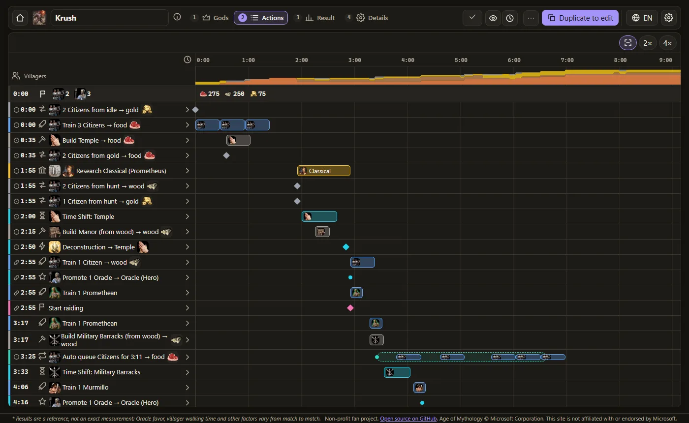
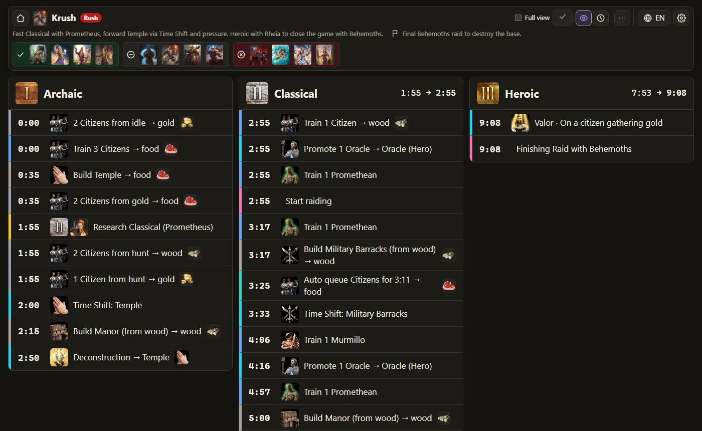

# AoM Retold · Build Order Builder

Build and simulate build orders for **Age of Mythology: Retold** (1v1, base game). Plan every action, and the simulator shows when it really happens: resources second by second, villagers on each resource, population, age-up times, production per building and warnings when something has to wait. Free, open source, and everything runs in the browser.

**▶ [Open the app](https://brunopb.github.io/AoMBuildOrderBuilder/)**





- Every game number comes from the game files, with its source recorded (`src/data`).
- Standard builds, your own builds saved in the browser, share links, and a match mode to follow a build while you play.
- Português and English.

> **Português:** um criador e simulador de build orders para Age of Mythology: Retold, gratuito e de código aberto. Achou um erro ou tem uma ideia? [Abra uma issue](https://github.com/BrunoPB/AoMBuildOrderBuilder/issues/new/choose). Quer ajudar no código ou nos dados? Veja o [guia de contribuição](CONTRIBUTING.md).

## Contributing

Bug reports, wrong game numbers, ideas, standard builds and code are all welcome: see [CONTRIBUTING.md](CONTRIBUTING.md) and the [Code of Conduct](CODE_OF_CONDUCT.md).

## Requirements

Node 22+ and npm.

## Quick start (Windows)

Double-click `start.bat` (or run `start.bat 5180` for another port). It installs the dependencies with `install.bat` the first time, then serves the site at http://localhost:5173.

## Commands

```bash
npm install
npm run dev          # dev server at http://localhost:5173
npm test             # unit, golden (Krush), data, i18n and API tests (Vitest)
npm run test:e2e     # Playwright smoke tests (run `npm run build` first; `npx playwright install chromium` once)
npm run lint         # ESLint + Prettier check
npm run check-data   # validates the game database and lists low-confidence values
npm run compare:krush # Krush preset vs the measured match (reference only)
npm run build        # type check + Vite build + static API in dist/
npm run preview      # serves dist/
```

## Deploy

`dist/` is a plain static site. Set `BASE_PATH` when it is served from a sub-folder and `SITE_URL` to make the API URLs absolute:

```bash
BASE_PATH=/AoMBuildOrderBuilder/ SITE_URL=https://<user>.github.io/AoMBuildOrderBuilder/ npm run build
```

GitHub Pages: `.github/workflows/ci.yml` deploys `master` when the repository variable `PAGES_ENABLED` is `true` (Settings → Pages → Source: GitHub Actions). GitHub Pages on a private repository needs a paid plan.

### Standard builds proposed by players

Standard builds are the files in `src/presets/`; a merge is the approval. Players propose one from the app (build menu → **Propose as standard build**), which opens the issue form `.github/ISSUE_TEMPLATE/propose-build.yml` filled in with the build's share link. `.github/workflows/build-proposal.yml` then checks the build (`scripts/propose-build.ts`: decode, validate, simulate without errors), comments the result on the issue and, when it passes, opens a pull request adding `src/presets/<name>.json`.

One-time setup on GitHub:

- the repository is public (players need to see it to open issues);
- a label named `build-proposal` exists (the form applies it);
- Settings → Actions → General → **Allow GitHub Actions to create and approve pull requests** (the default token can stay read-only: the workflow asks for its own write permissions);
- optional: Settings → General → **Automatically delete head branches**, so merged proposal branches go away.

With `gh` (owner login) the last three are:

```bash
gh label create build-proposal --color 7c3aed --description "A build proposed as a standard build"
gh api -X PUT repos/{owner}/{repo}/actions/permissions/workflow -f default_workflow_permissions=read -F can_approve_pull_request_reviews=true
gh repo edit --delete-branch-on-merge
```

Pull requests opened by the workflow do not start `ci.yml` by themselves (GitHub rule for `GITHUB_TOKEN`); the proposal workflow already runs the preset test, and CI runs again on `master` after the merge.

### Static API

`npm run build` writes `dist/api/v1/` (index, presets, dashboard format, simulated timelines in pt-BR and en, game data, icon manifest). GitHub Pages already sends `Access-Control-Allow-Origin: *`. On other hosts, add that header for `/api/*` so other sites can read it, e.g. Netlify `_headers`:

```
/api/*
  Access-Control-Allow-Origin: *
```

## Updating the game data

1. Edit the JSON in `src/data/` (schemas in `src/data/schema.ts`). Every value needs `meta.source`, `checkedAt` and `confidence`.
2. Record sources and conflicts in `data-research/SOURCES.md`, open items in `data-research/PENDING.md` and the change in `data-research/changelog.md`.
3. God powers are researched per pantheon in `data-research/<pantheon>/powers.json`; `npx tsx scripts/merge-powers.ts` rebuilds `src/data/powers.json`.
4. Icons come from the installed game: `npm run game-icons -- "<game folder>"` (see below).
5. `npm run check-data && npm test`.

## Icons from the game

The icons in `public/icons/` are copied from an installed Age of Mythology: Retold (build 19.17020). The script reads the game's archives without changing them (`game/data/Data.bar` for proto.xml, techtree.xml, the god and god-power files and the English names; `game/ui/UITextureCache4K.bar` / `UITextureCache.bar` for the DDS icons), matches each icon id in the data to its game object by English name, and writes `<id>-64.webp` / `<id>-128.webp` plus the manifest entry (`origin` = path inside the game):

```bash
python -m pip install --user Pillow
python scripts/game-icons.py "C:/Program Files (x86)/Steam/steamapps/common/Age of Mythology Retold"
python scripts/game-icons.py "<game folder>" --report   # show the mapping, write nothing
```

Ids the script cannot match keep their current icon and are listed at the end; concepts and renamed entities are mapped by hand in `MANUAL` at the top of the script. Only the WebP files are committed, never extracted game files.

## Project layout

```
src/data       game database (JSON) + zod schemas + loader
src/engine     simulator (pure functions), build format, timeline formatter
src/i18n       pt-BR / en messages
src/presets    standard builds (read-only)
src/storage    localStorage + migrations
src/io         import/export, dashboard (custom_builds) format
src/api        static API generator
src/ui         Preact UI
scripts        build-api, check-data, game-icons.py, merge-powers
data-research  research notes, sources, pending items
tests          Vitest + Playwright
```

## License

The code is under the [MIT license](LICENSE). Game names, icons and images (`public/icons/`) are © Microsoft Corporation and are not covered by it: they are used as fan content under the [Microsoft Game Content Usage Rules](https://www.xbox.com/en-US/developers/rules).

Age of Mythology © Microsoft Corporation. Non-profit fan project, not affiliated with or endorsed by Microsoft.
